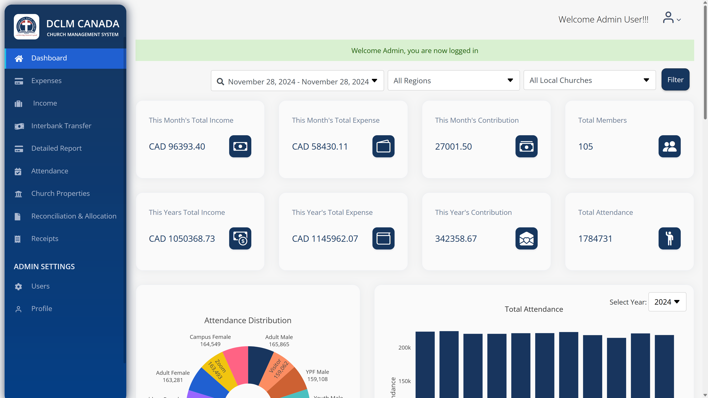
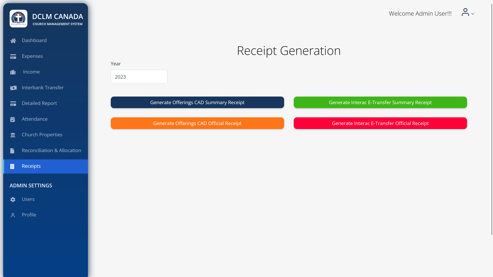
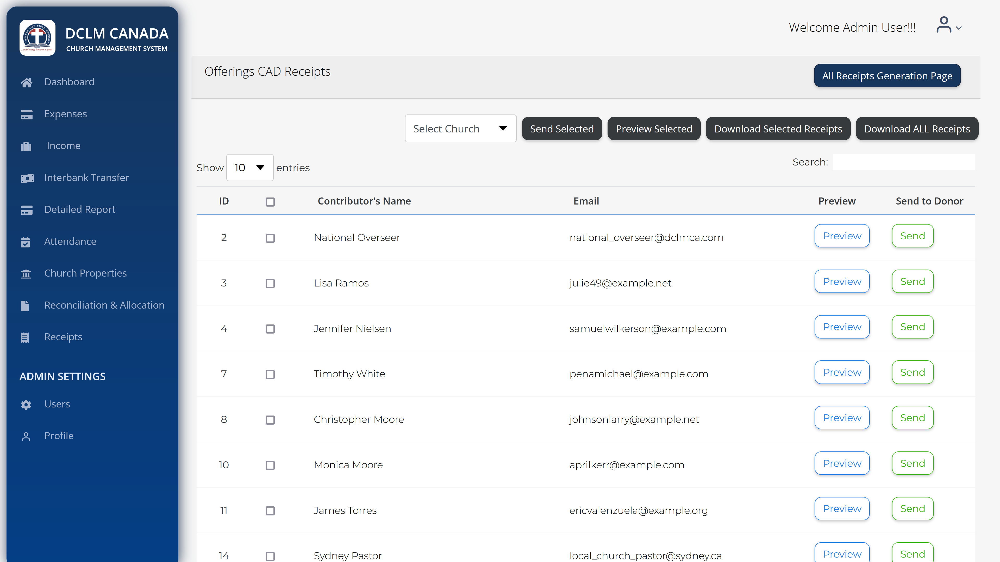

# DCLM Charity Organization Application Documentation

---

---

Welcome to the **DCLM Canada Church Management System**

---

## General Features for All Users

1. **Dashboard**: Overview of church activities and updates.

2. **Profile**: View and edit your profile details.

3. **Authentication**: Includes login, logout, registration, password reset, and activation processes.

---

## Role-Based Guides

### Member

As a member, you can:

- Access your **Profile** to update personal details.

- Explore the **Dashboard** for church updates.

---

### Local Church Pastor

In addition to member privileges, you can manage:

1. **Expenses**:
    - View, add, edit, and delete church expenses.
    - Generate reports and categorize expenses.

2. **Income**:
    - Manage income sources such as **Tithe & Offerings** (CAD/USD) and other donations.
    - Add and view cash or bank donations.

3. **Attendance**:
    - Add, edit, and manage church attendance records.

4. **Cash Donations**:
    - Track all cash-related transactions.

5. **Church Services**:
    - Manage schedules and related resources.

---

### Region Overseer

As a region overseer, you inherit all privileges of a local church pastor. You can also:

- Perform **Interbank Transfers**.
- Access **Detailed Reports** for better financial oversight.

---

### National Overseer
As a national overseer, you hold the highest level of permissions. In addition to all region overseer functionalities:

1. **User Management**:
    - Invite new users and activate/deactivate accounts.
    - Upload user data and generate user reports.

2. **Reports & Receipts**:
    - Generate offering and interac reports.
    - Send letters and receipts for financial transparency.

3. **Admin Settings**:
    - Manage advanced configurations and permissions.

---

## FAQs

1. **How do I reset my password?**
    - Go to the login page and click on "Forgot Password."

2. **How do I update my profile?**
    - Navigate to the "Profile" section and click "Edit."

3. **Who do I contact for technical issues?**
    - Reach out to [support@dclmcanada.com](mailto:support@dclmcanada.com).

---

## Table of Contents

1. [Overview](#1-overview)
2. [User Roles and Permissions](#2-user-roles-and-permissions)
3. [Middleware for Authorization](#3-middleware-for-authorization)
4. [Features and Functionality](#4-features-and-functionality)
5. [Dashboard Visualization](#5-dashboard-visualization)

---

## 1. Overview

This application is designed to manage the income and expenditure of a charity organization that operates multiple
branches along with a central headquarters. The system enables both the branch leaders and the headquarters staff to
manage financial data, track expenses and income, and generate tax receipts for contributors.

---

## Concept of Users

### MiscellaneousUser

A Miscellaneous Donor is when a user that is not registered makes a donation or contribution.
When a MiscellaneousUser makes a contribution the contribution is saved as a Miscellaneous contribution, if such a
contribution is taken from the bank statement a MiscellaneousUser is also created if not already created, with the 
bank name and the contribution goes to Miscellaneous contribution.

A miscellaneous user must have a valid Full Name and Email, to be registered as a regular user. 
These details are essential to issue tax receipts for their contributions.

Only registered users are eligible to receive tax receipts for their contributions. 

---

### **Levels of Users**

There are four levels of users. This you can find in the User model.
`authentication.models.User`

| Role ID | Role Name           |
|---------|---------------------|
| 1       | member              |
| 2       | local_church_pastor |
| 3       | national_overseer   |
| 4       | region_overseer     |

### Description:

- **MEMBER (1)**: Basic level user, typically a church member.
- **LOCAL_CHURCH_PASTOR (2)**: A pastor who manages a local church branch.
- **REGION_OVERSEER (4)**: Oversees multiple local churches within a specific region.
- **NATIONAL_OVERSEER (3)**: Oversees multiple branches at the national level.

- **NOTE**: All leaders, admin or hierarchy are also regarded as members of the church.

---

### Church Application Core Functionality

The general functionality is that, this is a Church app, so you have church, then you have members, then you have the
pastor, then you have, somebody that this pastor report to, which is the regional overseer, then the region overseers
report to the national overseer. All of them are still members of the church.

---

---

## **App Structure and User Roles**

The app follows a hierarchical structure that mimics the church organization:

- **Members**: These are individuals who are part of the church community.
- **Local Church Pastor**: Each local church has a pastor who oversees the congregation and activities at the branch
  level.
- **Region Overseer**: The region overseer manages multiple local churches and reports to the national overseer.
- **National Overseer**: The highest level in the hierarchy, responsible for overseeing the entire church organization.

### **Tax Receipt Generation**

In Canada, as the church is a registered charity, it must issue tax receipts to its members. These receipts are used by
members to file their taxes at the end of the year.

- **End Goal**: The application enables the church to generate tax receipts for donations at the end of each year.
- **Permissions**: Only **National Overseers** and **Region Overseers** have the ability to
  generate and manage these
  receipts. **Admins** also have access to receipts, while **Local Church Pastors** do not.

## **Income Management**

The app supports various types of income generated by the church, including bank donations and offerings:

- **Cash**: Members can donate cash during church services in either Canadian or US dollars.
-
    - **Tithe and Offering**: Tithes and offerings are paid by church members in both Canadian and US dollars.

- **Online**: Donations can also be made through bank transfers or online payment methods.
- **Others**: Other form of donation used.

The app allows users to add offerings by:

1. Selecting the local church.
2. Selecting a donor from the database.
3. Choosing the donation date.
4. Entering the donation amount.

### **Concept of Donors**

There are different types of donors and contributions in the system:

- **Miscellaneous Donor**: A donor who is not registered in the church’s database. These donors are typically one-time
  or anonymous contributors who do not have a profile in the system.

- **Anonymous Donor**: A donor who prefers to remain anonymous, meaning no personal details are associated with their
  donation.

- **Special Contribution**: A donation made for a specific project or cause. These donations are marked with a "star" in
  the user interface (UI) and have a unique background color to differentiate them from regular contributions. The
  background color helps users easily identify the type of contribution.

## **Import and Upload Feature**

To simplify the process of managing donation, attendance, services, receipts, contributions, and more the app provides
an **import and upload feature**. This feature allows users to import donation records from a file or bank statement,
making data entry easier and reducing manual input.

- **How It Works**:
    - Users can download a sample file or bank statement template that follows a predefined format.
    - Once the file is completed, it can be uploaded to the app.
    - The app automatically reads the file and populates the database with the donation records, ensuring that the
      information is processed efficiently and accurately.

This feature is particularly useful for church leaders or financial administrators who need to manage large volumes of
donation data in an organized manner.

---

## 2. User Roles and Permissions

The system has the following key roles:

- **Headquarters Officer**: Manages the headquarters finances, views all branches’ financial data, and generates tax
  receipts for contributors.
- **Branch Leader**: Manages the finances for their respective branch, including income and expenditure management, and
  possibly reconciling bank accounts for branches with separate accounts.
- **Contributor (User)**: A person who makes donations. Each contributor can only view their contributions and generate
  their tax receipts at the end of the year.

---

## 3. Middleware for Authorization

The **Authorization Middleware** is responsible for controlling access to different parts of the application based on
the user's role. It checks the URL being accessed and verifies if the logged-in user has permission to access that
particular resource. Permissions are defined for various roles in the application.

- **Role-based Permissions**:
    - **Public**: Accessible to all users (including unauthenticated users). For example, login, register, and password
      reset pages.
    - **Member**: Access to personal profile and contributions.
    - **Local Church Pastor**: Access to all features a member has, plus managing income, expenses, attendance, and
      donations.
    - **Region Overseer**: Inherits permissions of Local Church Pastor.
    - **National Overseer**: Inherits permissions of Local Church Pastor, plus access to user management, reports, and
      sending receipts.

- **Role-based Permissions Example**:
    - **Member**: Access to personal contributions and profile.
    - **Local Church Pastor & Region Overseer**: Manages income, expenses, attendance, and donations.
    - **National Overseer**: Manages user permissions, generates and sends tax receipts, and views all branch data.

This middleware ensures that only authorized users can access specific resources based on their role in the
organization.

---

## 4. Features and Functionality

### 4.1 Expenses

The **Expenses** app provides functionalities for managing church-related expenses. It allows categorization, record
tracking, uploading expenses, and generating sample files for uploads.

### 4.2 Income

The **Income** app is a financial management tool for churches, designed to track and manage income records,
including donations, contributions, and other sources of revenue.

### 4.3 Interbank Transfer

This is when a region transfers money from their account to another region.
This can be two ways:

- `Debit:` Sent the money to other region.
- `Credit:` Received money from another region.

### 4.4 Detailed Report

Detailed report is all about the church reports.

### 4.5 Attendance

Detailed report is all about the church reports.

### 4.6 Church Property

Church properly keeps records of all the church properties.

### 4.7 Reconciliation & Allocation

Users will have to select year, month and region for this to work.

### Reconciliation

Only **National Overseers** and **Region Overseers** have permission to this view.  
In addition to the data and records saved in the app, each local church also maintains its own records or bank
statements.  
At the end of the day, we need to verify that the data in the app matches the bank statements.

Users can:

1. **Download a sample file**.
2. **Choose their region**.
3. **Compare the app data with the bank statement**.
4. **Provide feedback** on any discrepancies.

---

### Payment Allocation

Each region or local church has its own bank account and collects donations or contributions.  
They are required to allocate these funds as follows:

- **30%** to DCLM.
- **10%** to GCK.

For **GCK Canada**, the allocation percentage is set by the admin, and regions must pay the amount specified.

#### Monthly Payment Process:

1. At the end of every month, regions must log into the app and input the amount they have paid.
2. If the amount paid is **less than the required allocation**, an email will be sent to remind them.
3. If the payment remains incomplete by the end of the next month:
    - Another email is sent.
    - The **General Overseer** is **CC’d** in the follow-up email.

---

## 5. Dashboard Visualization

Once logged in, each user (whether a branch leader or contributor) lands on their dashboard. The dashboard provides:

- A visualization of income, expenses, and other financial data for their branch or their personal contributions.
- The data is presented in graphs or charts for easy interpretation and monitoring of financial health.

---
